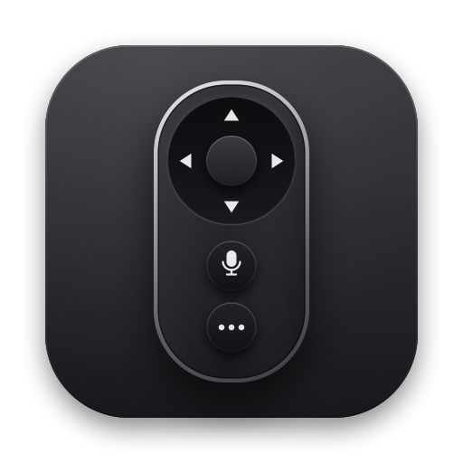

<p align="center">
  
</p>

<h1 align="center">ZAP</h1>

<p align="center"><strong>Your TV. One click away.</strong></p>

<p align="center">
A native macOS menu bar remote for Amazon Fire TV.<br>
<sub>A product of Cosmos · Open Source</sub>
</p>

<p align="center">
  
</p>

> **Status:** ZAP is available as source code. A signed and notarized download and the Homebrew cask will be
> published with the first notarized release; they are not available yet.

## Features

- **A remote in your menu bar:**
  - Rewind, Play/Pause and Fast-forward;
  - a circular D-pad with OK, plus Back, Home and Menu;
  - hold a direction to scroll;
  - the keyboard works while the remote is open.
- **Status at a glance:** a small capsule at the top of the remote shows your TV's name and connection. It
  briefly confirms what just happened: an app opened, the TV reconnected, an AirPlay receiver is ready, or
  what you said.
- **A menu bar status light:** the remote icon in the menu bar shows whether the TV is connected,
  reconnecting or unreachable, and when the microphone is on (see below).
- **Your apps, one click away:**
  - up to four shortcuts, chosen from the apps actually installed on your TV;
  - reorder, hide or replace them in Settings → Apps;
  - keys 1–4 open them.
- **Pairing that stays put:** ZAP finds Fire TVs on your network and pairs with the PIN shown on the TV. It
  finds the TV again when it gets a new address.
- **Voice, two ways:** hold to talk.
  - Italian commands are recognised on your Mac with Apple Speech ("Apri Netflix", "Vai a destra",
    "Conferma"…).
  - Or speak to Alexa through your Fire TV.
- **A Screen Mirroring helper:** ZAP opens the AirPlay receiver app on your TV and points you to macOS Screen
  Mirroring.
- **A native Settings window:** General, Device, Apps, Voice, Mirroring, Advanced and About.
- **Local-first:** no account, no analytics, no telemetry, no server of ours.

<p align="center">
  
</p>

## What ZAP can't do

- **Now Playing.** Fire TV doesn't tell remote apps the playing title, episode, artwork, progress or
  playback state, so ZAP never shows or guesses them. The investigation is in
  [docs/NOW_PLAYING.md](docs/NOW_PLAYING.md).
- **Volume and power.** They can't be controlled over the network on the verified device.
- **Channel switching and TV guides.** Not supported.
- **Mirroring on its own.** Screen Mirroring needs an AirPlay receiver app on the TV, and protected (DRM)
  video appears black.

## Requirements

- macOS 14 Sonoma or later on an Apple silicon Mac.
- A Fire TV on the same local network as your Mac. Verified on a Fire TV Stick (3rd Gen) with Fire OS 7.7.1.7.
  Other models are untested: see [COMPATIBILITY.md](COMPATIBILITY.md).

## Install

### Build from source

```sh
git clone https://github.com/skiliz/zap.git
cd zap
scripts/build.sh test           # builds "build/ZAP Remote.app" and runs the tests
open "build/ZAP Remote.app"
```

You need Xcode or just the Command Line Tools (`xcode-select --install`); there are no other dependencies.
Move `ZAP Remote.app` to Applications if you like.

### Signed download and Homebrew (with the first notarized release)

Once the first release signed with a Developer ID and notarized by Apple is published, you will be able to
install it with:

```sh
brew install --cask skiliz/tap/zap-remote
```

or by downloading the disk image from the [Releases](https://github.com/skiliz/zap/releases) page. ZAP is
never distributed unsigned, and you won't need to change any macOS security setting.

## Getting started

1. Open ZAP. If no TV is paired yet, Settings opens on **Device**.
2. Make sure the Mac and the Fire TV are on the same network. Allow ZAP to find devices on your local network
   when macOS asks.
3. Choose your Fire TV (or enter its address), click **Show PIN on TV**, and type the PIN the TV shows.
4. Click the remote icon in the menu bar. That's it.

### The menu bar status light

| Light | Meaning |
|---|---|
| Green dot | The TV confirmed the connection in the last 10 minutes |
| Hollow gray ring | Not checked recently. Open the remote to check: ZAP never checks in the background |
| Amber ring (blinks gently) | Reconnecting or looking for the TV |
| Red dot, dimmed remote | The TV is unreachable or rejected the pairing |
| Red microphone | ZAP is listening |
| Blue dot at the bottom | Your screen is shown on the TV through AirPlay |

The tooltip and VoiceOver describe the state in words.

## Voice control

Hold the Voice button in the remote (or **V** while the remote is open, or the optional **⌃⌥V** anywhere) and
speak; release to finish. The microphone is never on otherwise.

- **Apple Speech (default).** Your speech is recognised on your Mac. ZAP understands Italian commands such as
  *Apri Netflix*, *Home*, *Indietro*, *Conferma*, *Vai a destra / sinistra / su / giù*, *Pausa* and
  *Riprendi*. It doesn't send anything it isn't sure about. If your Mac can't recognise Italian on-device,
  nothing goes to Apple unless you turn on *Allow Apple server recognition* in Settings → Voice.
- **Alexa.** Your voice goes through the Fire TV to **Amazon's Alexa cloud service**, like the voice button on
  the Fire TV remote, and Alexa answers on the TV.

## Screen Mirroring

Fire TV Sticks don't support AirPlay out of the box, so you need an **AirPlay receiver app on the TV**.

- **AirPlay Server** is a free, open-source receiver
  ([github.com/jqssun/android-airplay-server](https://github.com/jqssun/android-airplay-server)). It worked in
  our tests; it isn't in Amazon's Appstore.
- Commercial receivers also exist.
- AirPlay receiver apps for Fire TV are third-party apps, not made or certified by Apple.

Click **Mirror** in ZAP: it opens the receiver on the TV and points you to **Control Center → Screen
Mirroring**, where you choose to mirror or extend your display. macOS doesn't let apps start mirroring by
themselves, so that last click is yours.

## Privacy

ZAP talks to:

- your Fire TV;
- by default, Amazon's image servers for the icons of your TV's apps (Settings → Advanced to turn off);
- in Alexa mode, Amazon's Alexa service.

There is no account, no analytics and no telemetry. The microphone is used only while you hold push-to-talk,
and no audio is stored. Pairing data stays in `~/Library/Application Support/ZAP Remote`, readable only by
you. The full details are in [PRIVACY.md](PRIVACY.md), and security in [SECURITY.md](SECURITY.md).

## Troubleshooting

- **"ZAP can't see your network":** allow ZAP in System Settings → Privacy & Security → Local Network, then
  search again.
- **The TV isn't found or shows "Device unavailable":**
  - the Mac and the TV must be on the same network, and the TV on;
  - some phone hotspots and guest networks isolate devices from each other;
  - you can enter the TV's address by hand when pairing.
- **"Pair again":** the TV rejected ZAP's pairing. Use Settings → Device → Pair Again.
- **Push-to-talk anywhere does nothing:** another app may already use ⌃⌥V. Settings → Voice tells you when
  that happens.
- **Voice is off:** check Microphone (and, for Apple Speech, Speech Recognition) in System Settings →
  Privacy & Security.
- **Mirroring finds no receiver:** install an AirPlay receiver app on the TV and open it once.

## Uninstall

1. If *Launch at login* is on, turn it off in Settings → General.
2. Quit ZAP (Settings → General → Quit ZAP) and move `ZAP Remote.app` to the Trash.
3. To remove the pairing and settings too, delete `~/Library/Application Support/ZAP Remote` and
   `~/Library/Preferences/local.fireremote.app.plist`.

Once it is available, `brew uninstall --cask zap-remote` removes the app and keeps your pairing; add `--zap`
to remove ZAP's data as well.

## Building and contributing

See [CONTRIBUTING.md](CONTRIBUTING.md). Reports from other Fire TV models are especially welcome.
[docs/PROTOCOL.md](docs/PROTOCOL.md) explains how ZAP talks to the TV, and
[docs/RELEASING.md](docs/RELEASING.md) how releases are built.

## License

[MIT](LICENSE). Third-party notices: [THIRD_PARTY_NOTICES.md](THIRD_PARTY_NOTICES.md).

---

<sub>ZAP is an independent third-party application and is not affiliated with, endorsed by, or sponsored by Amazon. Amazon, Fire TV, Fire OS and Alexa are trademarks of Amazon.com, Inc. or its affiliates. Apple, AirPlay and macOS are trademarks of Apple Inc., registered in the U.S. and other countries and regions. AirPlay receiver apps for Fire TV are third-party apps, not made or certified by Apple. ZAP is unrelated to the ZAP web security scanner (ZAP by Checkmarx, formerly OWASP ZAP).</sub>
