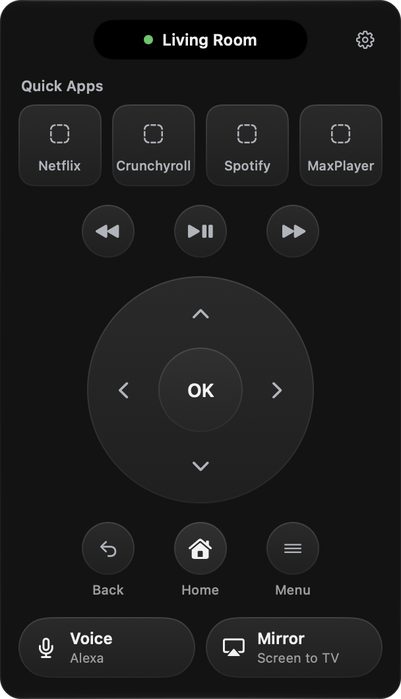
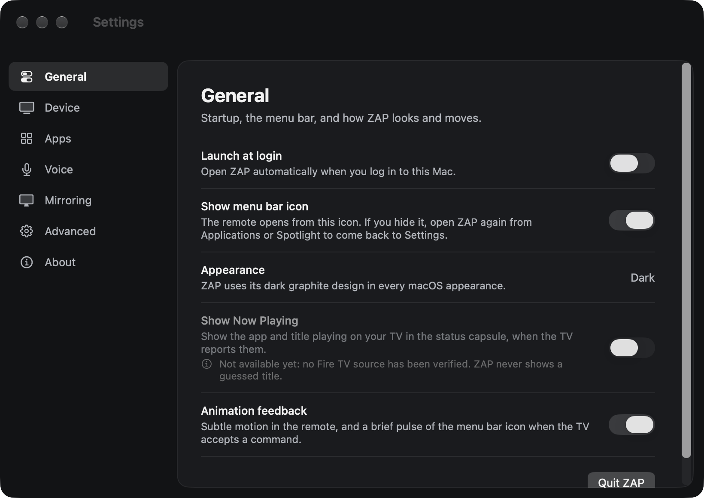
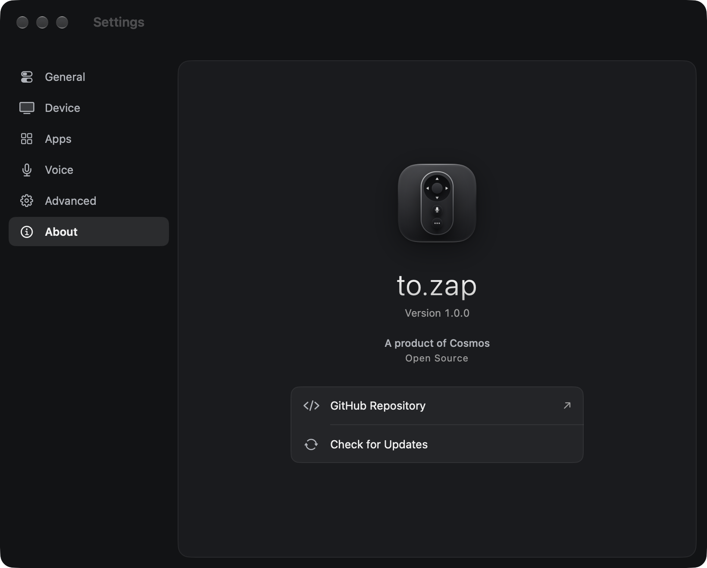

<p align="center">
  
</p>

<h1 align="center">to.zap</h1>

<p align="center"><strong>Your TV. One click away.</strong></p>

<p align="center">
A native macOS menu bar remote for Amazon Fire TV.<br>
<sub>A product of Cosmos · Open Source</sub>
</p>

<p align="center">
  
</p>

> **Status:** version 1.0.0 is available. Releases are free and open source, and **not signed with an Apple
> Developer ID or notarized by Apple**: see [Install](#install).

## Features

- **A remote in your menu bar:**
  - Rewind, Play/Pause and Fast-forward (what Rewind and Fast-forward do depends on the app on the TV);
  - a circular D-pad with OK, plus Back, Home and Menu;
  - hold a direction to scroll;
  - the keyboard works while the remote is open.
- **Status at a glance:** a small capsule at the top of the remote shows your TV's name and connection. It
  briefly confirms what just happened: an app opened, the TV reconnected, an AirPlay receiver is ready, or
  what you said.
- **A menu bar status light:** the remote icon in the menu bar shows whether the TV is connected,
  reconnecting or unreachable, and when the microphone is on (see below).
- **Your apps, one click away:**
  - up to four shortcuts, chosen from the apps actually installed on your TV;
  - reorder, hide or replace them in Settings → Apps;
  - keys 1–4 open them.
- **Pairing that stays put:** to.zap finds Fire TVs on your network and pairs with the PIN shown on the TV. It
  finds the TV again when it gets a new address.
- **Voice, two ways:** hold to talk.
  - Italian commands are recognised on your Mac with Apple Speech ("Apri Netflix", "Vai a destra",
    "Conferma"…).
  - Or speak to Alexa through your Fire TV.
- **A Screen Mirroring helper:** to.zap opens the AirPlay receiver app on your TV and points you to macOS Screen
  Mirroring. macOS and the receiver do the streaming; to.zap never handles video.
- **Check for Updates** in Settings → About, only when you click it.
- **A native Settings window:** General, Device, Apps, Voice, Advanced and About.
- **Local-first:** no account, no analytics, no telemetry, no server of ours.

<p align="center">
  
</p>

<p align="center">
  
</p>

## What to.zap can't do

- **Now Playing.** Fire TV doesn't tell remote apps the playing title, episode, artwork, progress or
  playback state, so to.zap never shows or guesses them. The investigation is in
  [docs/NOW_PLAYING.md](docs/NOW_PLAYING.md).
- **Previous / next episode, track or channel.** Fire TV's remote interface has no such command (tested,
  see [docs/PROTOCOL.md](docs/PROTOCOL.md)), so to.zap offers Rewind and Fast-forward instead of pretending.
- **Volume and power.** They can't be controlled over the network on the verified device.
- **Channel switching and TV guides.** Not supported.
- **Mirroring on its own.** Screen Mirroring needs an AirPlay receiver app on the TV, and protected (DRM)
  video appears black.

## Requirements

- macOS 14 Sonoma or later on an Apple silicon Mac (tested on macOS 27).
- A Fire TV on the same local network as your Mac. Verified on a Fire TV Stick (3rd Gen) with Fire OS 7.7.1.7.
  Other models are untested: see [COMPATIBILITY.md](COMPATIBILITY.md).

## Install

### Download

Download `tozap-1.0.0.zip` (or the `.dmg`) from the [Releases](https://github.com/skiliz/tozap/releases) page,
check it against `SHA256SUMS.txt` if you like (`shasum -a 256 tozap-1.0.0.zip`), and move **to.zap** to
Applications.

### Homebrew

```sh
brew install --cask skiliz/tap/tozap-remote
```

### The first launch: approving an app that isn't notarized

to.zap is distributed without a paid Apple Developer account, so it is **not signed with a Developer ID and not
notarized by Apple** — Apple hasn't checked it. macOS therefore says it can't verify to.zap the first time you
open it. If you downloaded it from this repository's releases or installed it with the Homebrew tap above:

1. Open **to.zap** from Applications, and click **Done** in the warning (**Cancel** on macOS 14).
2. Within about an hour, open **System Settings → Privacy & Security**, scroll to **Security**, click
   **Open Anyway** next to the message about to.zap, and enter your login password.
3. Click **Open** to confirm.

On macOS 14 Sonoma you can instead Control-click the app in Finder and choose **Open**. You never need to turn
off Gatekeeper or change other security settings. Because each release is a new, unnotarized app to macOS,
it asks again after every update, and may ask again for Microphone, Speech Recognition and Local Network
access. If you'd rather not trust a prebuilt app, build it yourself:

### Build from source

```sh
git clone https://github.com/skiliz/tozap.git
cd tozap
scripts/build.sh test           # builds "build/to.zap.app" and runs the tests
open "build/to.zap.app"
```

You need Xcode or just the Command Line Tools (`xcode-select --install`); there are no other dependencies.
Move `to.zap.app` to Applications if you like. An app you build yourself opens without the approval step.

### Updates

to.zap never checks for updates by itself. In **Settings → About**, click **Check for Updates**: to.zap asks GitHub
once for the latest stable release and tells you whether a newer version exists. It never downloads or
installs anything.

- Installed with Homebrew: `brew upgrade --cask skiliz/tap/tozap-remote` (your pairing and settings are kept).
- Downloaded: get the new version from its release page and replace the app in Applications.

## Getting started

1. Open to.zap. If no TV is paired yet, Settings opens on **Device**.
2. Make sure the Mac and the Fire TV are on the same network. Allow to.zap to find devices on your local network
   when macOS asks.
3. Choose your Fire TV (or enter its address), click **Show PIN on TV**, and type the PIN the TV shows.
4. Click the remote icon in the menu bar. That's it.

### The menu bar status light

| Light | Meaning |
|---|---|
| Green dot | The TV confirmed the connection in the last 10 minutes |
| Hollow gray ring | Not checked recently. Open the remote to check: to.zap never checks in the background |
| Amber ring (blinks gently) | Reconnecting or looking for the TV |
| Red dot, dimmed remote | The TV is unreachable or rejected the pairing |
| Red microphone | to.zap is listening |
| Blue dot at the bottom | Your Mac is using the TV as an AirPlay display (verified when extending the desktop) |

The tooltip and VoiceOver describe the state in words.

## Voice control

Hold the Voice button in the remote (or **V** while the remote is open, or the optional **⌃⌥V** anywhere) and
speak; release to finish. With Full Keyboard Access or VoiceOver, activating the button starts listening and
activating it again stops. The microphone is never on otherwise, and never for more than 15 seconds.

- **Apple Speech (default).** Your speech is recognised on your Mac. to.zap understands Italian commands such as
  *Apri Netflix*, *Home*, *Indietro*, *Conferma*, *Vai a destra / sinistra / su / giù*, *Pausa* and
  *Riprendi*. It doesn't send anything it isn't sure about. If your Mac can't recognise Italian on-device,
  nothing goes to Apple unless you turn on *Allow Apple server recognition* in Settings → Voice.
- **Alexa.** Your voice goes through the Fire TV to **Amazon's Alexa cloud service**, like the voice button on
  the Fire TV remote, and Alexa answers on the TV.

## Screen Mirroring

Fire TV Sticks don't support AirPlay out of the box, so you need an **AirPlay receiver app on the TV**.

- **AirPlay Server** is a free, open-source receiver
  ([github.com/jqssun/android-airplay-server](https://github.com/jqssun/android-airplay-server)). It worked in
  our tests; it isn't in Amazon's Appstore.
- Commercial receivers also exist.
- AirPlay receiver apps for Fire TV are third-party apps, not made or certified by Apple.

Click **Mirror** in to.zap: it opens the receiver on the TV, checks that your Mac can see it, and points you to
**Control Center → Screen Mirroring**, where you choose to mirror or extend your display. macOS doesn't let apps
start mirroring by themselves, so that last click is yours. To stop, choose Stop Mirroring there.

to.zap doesn't stream video: macOS sends the screen and the receiver app shows it. Mirroring keeps running if you
quit to.zap. How to install the receiver, what it does on your network, and what was tested:
[docs/MIRRORING.md](docs/MIRRORING.md).

## Privacy

to.zap talks to:

- your Fire TV;
- by default, Amazon's image servers for the icons of your TV's apps (Settings → Advanced to turn off);
- in Alexa mode, Amazon's Alexa service;
- Apple's speech servers, only if your Mac can't recognise Italian on-device and you allow it in Settings → Voice;
- GitHub, only when you click Check for Updates.

There is no account, no analytics and no telemetry. The microphone is used only during push-to-talk (at most
15 seconds), and no audio is stored. Pairing data stays in `~/Library/Application Support/to.zap`, readable only by
you. The full details are in [PRIVACY.md](PRIVACY.md), and security in [SECURITY.md](SECURITY.md).

## Troubleshooting

- **"to.zap can't see your network":** allow to.zap in System Settings → Privacy & Security → Local Network, then
  search again.
- **The TV isn't found or shows "Device unavailable":**
  - the Mac and the TV must be on the same network, and the TV on;
  - some phone hotspots and guest networks isolate devices from each other;
  - you can enter the TV's address by hand when pairing.
- **"Pair again":** the TV rejected to.zap's pairing. Use Settings → Device → Pair Again.
- **Push-to-talk anywhere does nothing:** another app may already use ⌃⌥V. Settings → Voice tells you when
  that happens.
- **Voice is off:** check Microphone (and, for Apple Speech, Speech Recognition) in System Settings →
  Privacy & Security.
- **Mirroring finds no receiver:** install AirPlay Server on the TV ([docs/MIRRORING.md](docs/MIRRORING.md))
  and open it once. If it says "error starting server", another receiver app is using the AirPlay port.
- **"Apple could not verify to.zap…":** expected for a release that isn't notarized; approve it with
  **Open Anyway** as described in [Install](#install).

## Uninstall

1. If *Launch at login* is on, turn it off in Settings → General.
2. Quit to.zap (Settings → General → Quit to.zap) and move `to.zap.app` to the Trash.
3. To remove the pairing and settings too, delete `~/Library/Application Support/to.zap` and
   `~/Library/Preferences/local.tozap.app.plist`.

With Homebrew, `brew uninstall --cask tozap-remote` removes the app and keeps your pairing; add `--zap` to remove
to.zap's data as well.

## Building and contributing

See [CONTRIBUTING.md](CONTRIBUTING.md). Reports from other Fire TV models are especially welcome.
[docs/PROTOCOL.md](docs/PROTOCOL.md) explains the Fire TV interface to.zap uses, and
[docs/RELEASING.md](docs/RELEASING.md) how releases are built.

## License

[MIT](LICENSE). Third-party notices: [THIRD_PARTY_NOTICES.md](THIRD_PARTY_NOTICES.md).

---

<sub>to.zap is an independent third-party application and is not affiliated with, endorsed by, or sponsored by Amazon. Amazon, Fire TV, Fire OS and Alexa are trademarks of Amazon.com, Inc. or its affiliates. Apple, AirPlay and macOS are trademarks of Apple Inc., registered in the U.S. and other countries and regions. AirPlay receiver apps for Fire TV are third-party apps, not made or certified by Apple. to.zap is unrelated to the ZAP web security scanner (ZAP by Checkmarx, formerly OWASP ZAP) and to other products named ZAP or Tozap. Other product names are trademarks of their respective owners and are used only to describe compatibility.</sub>
